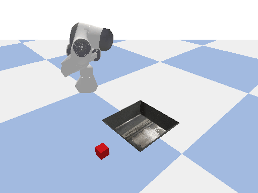
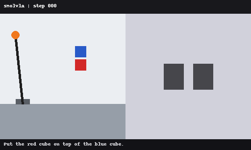
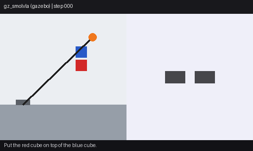
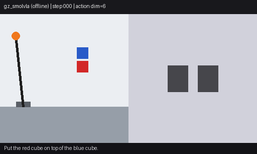
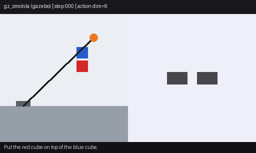

# vla_ros2

ROS2-native on-robot runtime for Vision-Language-Action (VLA) models.

[](https://github.com/rsasaki0109/vla_ros2/actions/workflows/ci.yml)
[](pyproject.toml)
[](LICENSE)
[](ros2)

> VLA models move fast; robots need a stable runtime interface.
> `vla_ros2` wires **camera + instruction + robot state** to **typed actions**
> and publishes them on ROS2 topics, running inference locally on the robot.

```text
camera + instruction + robot state + timestamp
  -> stable VLA adapter boundary (local inference)
  -> typed VLAAction / VLAActionChunk
  -> ROS2 topic (/vla/action, /vla/action_chunk) + /diagnostics
```

This project was previously `vla_zoo`, a broad runtime/benchmark/adapter hub.
It has been refocused into a single job: **run a VLA policy on a robot through
ROS2**. Benchmarking, comparison reports, PyBullet demos, and the remote-GPU
HTTP path have been removed.

## Demos

### Scripted PyBullet (baseline runtime loop)



A **Franka Panda in a PyBullet physics sim** performing pick-and-place, driven
through the real `vla_ros2` runtime: every control tick builds a
`VLAObservation`, calls `load_model("scripted")`, and the returned
`VLAAction` end-effector delta + gripper channel command the arm. It is the
`scripted` baseline adapter (not a learned VLA), but the loop, the physics, and
the action stream are real.

Reproduce: [`scripts/record_sim_demo.py`](scripts/record_sim_demo.py)

### SmolVLA closed-loop (learned policy)



**Real SmolVLA inference** (`lerobot/smolvla_base`) in a closed loop on a
LeRobot-aligned SO-100 kinematic stand-in initialized from
`lerobot/svla_so100_stacking`. When available, the demo uses a fine-tuned checkpoint
under `checkpoints/smolvla_so100_stacking_20k/` instead of the base model.

Reproduce: [`scripts/record_smolvla_so100_demo.py`](scripts/record_smolvla_so100_demo.py)

Fine-tune on the same dataset (optional; improves task fit vs `smolvla_base` alone):

```bash
STEPS=20000 BATCH_SIZE=16 OUTPUT_DIR=checkpoints/smolvla_so100_stacking_20k ./scripts/finetune_smolvla_so100.sh
./scripts/record_finetuned_gz_demo.sh   # after training; rewrites gz_smolvla_demo.gif
```

Quick wiring check: `./scripts/finetune_smolvla_so100.sh` (200 steps).

### SmolVLA × Gazebo actuation (ROS2 closed loop)



**Real SmolVLA inference** through the ROS2 runtime, SO-100-style camera rendered from
live `joint_states`, and 6D joint commands into `joint_trajectory_controller`.
Camera views are synthetic (not Gazebo RGB); joint motion is from the real sim graph.
Demo GIF uses a fine-tuned checkpoint (`checkpoints/smolvla_so100_stacking_20k/`).

Reproduce: [`scripts/record_gz_smolvla_demo.sh`](scripts/record_gz_smolvla_demo.sh)

#### base vs fine-tuned (same episode, 2026-06-09)

Instruction: *Put the red cube on top of the blue cube.* (`svla_so100_stacking`
episode 0). Metrics: [`docs/assets/gz_smolvla_compare_metrics.json`](docs/assets/gz_smolvla_compare_metrics.json).

**Offline kinematic loop** (60 steps, blend 0.35) — policy difference is visible:

| checkpoint | max joint Δ | GIF |
|---|---:|---|
| `lerobot/smolvla_base` | 175.5 |  |
| fine-tuned 20k | 7.6 |  |

**Gazebo closed loop** (60 s capture after runtime warmup, actuation on) —
inference publishes `/vla/action` (42–44 msgs/run). Joint displacement in sim
remains negligible (`max_joint_delta_rad` ≪ 1e-6); actuation scaling is still
under investigation:

| checkpoint | actions | max joint Δ (rad) | GIF |
|---|---:|---:|---|
| `lerobot/smolvla_base` | 42 | ~0 |  |
| fine-tuned 20k | 44 | ~0 |  |

Reproduce both: [`scripts/record_gz_smolvla_compare.sh`](scripts/record_gz_smolvla_compare.sh)

Launch manually: [ros2/SIM.md](ros2/SIM.md) (`gz_smolvla.launch.py`; GPU required).

### VLA Playground (browser)

Try adapters locally or drive a **Gazebo sim graph** (no real robot):

```bash
pip install -e ".[playground,smolvla]"

# Local inference or side-by-side adapter comparison (first tab)
python scripts/vla_playground.py

# Gazebo closed loop + browser (two terminals)
./scripts/launch_playground_gz.sh
python scripts/vla_playground.py --ros
# open http://127.0.0.1:7860 → "ROS2 live" tab → Send instruction
```

## Adapter comparison (measured locally)

Same synthetic input through each adapter: instruction
`stack the red block on the blue block`, state `[0, 45, 90, 0, 0, 0.5]`,
256×256 RGB frame (seed 0). Measured on **GPU** with
`.venv-smolvla` on **2026-06-08**.

This compares **runtime wiring and latency**, not robot task success. Action
dimensions differ by adapter (7-DoF eef delta vs 6-DoF joint-style SmolVLA).

| model | checkpoint | ok | load | infer | shape | action (preview) |
|---|---|---:|---:|---:|---|---|
| `dummy` | — | yes | 0.6 ms | 0.0 ms | 7 | all zeros |
| `random` | — | yes | 0.5 ms | 0.1 ms | 7 | seeded random eef delta |
| `scripted` | — | yes | 0.0 ms | 0.1 ms | 7 | `[0.2, -0.1, 0.2, 0, 0, 0, 1]` |
| `smolvla` | `lerobot/smolvla_base` | yes | 40.6 s | 1014 ms | 6 | `[-0.29, 0.15, 0.22, 0.27, 1.67, -0.08]` |
| `smolvla` | fine-tuned 20k | yes | 33.1 s | 1224 ms | 6 | `[2.63, 95.39, 111.53, 43.74, 57.35, 5.95]` |
| `pi0` | `lerobot/pi0_base` | no | — | — | — | gated HF repo (token required) |
| `openvla` | `openvla/openvla-7b` | no | — | — | — | `[openvla]` extra not installed |

Fine-tuned SmolVLA outputs larger-magnitude 6D actions on this synthetic frame
than `smolvla_base`; that reflects checkpoint fit, not a sim/robot success rate.

Reproduce:

```bash
.venv-smolvla/bin/python scripts/compare_vla_models.py \
  --models dummy random scripted smolvla \
  --instruction "stack the red block on the blue block" \
  --state-json '{"state": [0, 45, 90, 0, 0, 0.5]}' \
  --device cuda \
  --out docs/assets/vla_compare_local.json

.venv-smolvla/bin/python scripts/compare_vla_models.py \
  --models smolvla \
  --pretrained smolvla=checkpoints/smolvla_so100_stacking_20k/checkpoints/020000/pretrained_model \
  --instruction "stack the red block on the blue block" \
  --state-json '{"state": [0, 45, 90, 0, 0, 0.5]}' \
  --device cuda \
  --out docs/assets/vla_compare_smolvla_finetuned.json
```

Full summary: [`docs/assets/vla_compare_summary.json`](docs/assets/vla_compare_summary.json)

## Layout

```text
src/vla_ros2/         Python package (adapter runtime)
  core/               typed contracts: VLAObservation/Action/ActionChunk, registry
  adapters/           dummy, random, scripted, openvla, smolvla, pi0, groot
  runtime/            local runtime, action-clip guard + watchdog, diagnostics
  cli/                minimal off-robot sanity CLI (vla-ros2 list / predict)
ros2/vla_ros2/        ROS2 ament_python package: runtime node, launch, config
ros2/vla_ros2_msgs/   ROS2 messages: VLAAction, VLAActionChunk, VLAStatus, VLAInstruction
```

## Install (Python package)

```bash
pip install -e .                 # core runtime + minimal CLI
pip install -e ".[openvla]"      # + OpenVLA dependencies
pip install -e ".[smolvla]"      # + SmolVLA (LeRobot) dependencies
pip install -e ".[playground]"   # + Gradio browser playground
pip install -e ".[vlm]"          # + SmolVLM2 success detector
pip install -e ".[dev]"          # + test/lint tooling
```

Sanity-check adapters off-robot, without ROS2:

```bash
vla-ros2 list                              # list registered adapters
vla-ros2 predict --model dummy             # run one local inference (wiring check)
vla-ros2 compare -m dummy -m random -m scripted   # same input, side-by-side actions
python scripts/compare_vla_models.py --models dummy smolvla --device cuda
```

## Run (ROS2 node)

Build the workspace first — see [ros2/WORKSPACE.md](ros2/WORKSPACE.md) or run
`./scripts/bootstrap_ros2_workspace.sh`.

The runtime node loads an adapter, subscribes to image/instruction/state, runs
local inference at `control_hz`, and publishes typed actions plus a diagnostics
record. It defaults to `dry_run: true` for safe bring-up.

```bash
source install/setup.bash
export PYTHONPATH="$PWD/src:$PYTHONPATH"

# dummy adapter, no GPU / weights required
ros2 launch vla_ros2 dummy.launch.py

# OpenVLA local inference (needs a GPU and openvla extras)
ros2 launch vla_ros2 openvla.launch.py dry_run:=false
```

`ros2 launch vla_ros2 smoke.launch.py` brings up the runtime node plus a
synthetic-input node, and a real typed `VLAAction` flows on `/vla/action`.

For real-robot wiring (topic remaps, clip calibration, phased `dry_run`
bring-up), see [ros2/BRINGUP.md](ros2/BRINGUP.md).

For Gazebo Sim (spawn arm, bridge `/vla/action` to `joint_trajectory_controller`),
see [ros2/SIM.md](ros2/SIM.md).

### Topics

| Direction | Topic (default) | Type |
|---|---|---|
| in  | `/camera/image_raw` | `sensor_msgs/Image` |
| in  | `/vla/instruction` | `std_msgs/String` or `vla_ros2_msgs/VLAInstruction` |
| in  | `/joint_states` | `sensor_msgs/JointState` |
| out | `/vla/action` | `vla_ros2_msgs/VLAAction` |
| out | `/vla/action_chunk` | `vla_ros2_msgs/VLAActionChunk` |
| out | `/vla/status` | `vla_ros2_msgs/VLAStatus` |
| out | `/vla/task_status` | `vla_ros2_msgs/VLATaskStatus` (VLM success detector, optional) |
| out | `/diagnostics` | `diagnostic_msgs/DiagnosticArray` |

### Async chunk execution

Chunked policies (SmolVLA predicts 50 steps per call, ~1 s on GPU) stall the arm
for the whole inference if each call waits for the previous chunk to finish.
`async_chunks:=true` publishes one buffered action per control tick and requests
the next chunk early (when the buffer is down to the measured inference latency
in ticks, or `chunk_refill_steps`); a chunk inferred from an observation taken
`k` ticks ago starts `k` steps in. The buffer is cleared on a new instruction
or stale inputs. Output is continuous only when a chunk spans at least **twice**
the inference latency in ticks (half goes stale in flight, half covers the next
inference): SmolVLA's 50-step chunk at ~1 s and 10 Hz (10 ticks) qualifies; the
node warns when it does not.

```bash
ros2 run vla_ros2 vla_runtime_node --ros-args -p async_chunks:=true \
  -p model_name:=dummy -p model_kwargs_json:='{"chunk_size": 10, "latency_sec": 0.5}'
```

`ros2-smoke` runs both modes side by side with a simulated 0.5 s inference
(`tests/test_async_chunks_launch.py`) and requires the async node to hold ≥ 70 %
of `control_hz` with no gap ≥ 0.35 s. First CI run, with 10-step chunks (below
the 2× rule): sync 1.43 Hz (max gap 0.70 s) vs async 6.84 Hz (max gap 0.30 s);
the test now uses 20-step chunks.

### Safety

- `dry_run` defaults to `true`; actions are not published until you opt in.
- An action-clip guard bounds every action to `[action_low, action_high]`.
- A watchdog flags stale/missing images and instructions and downgrades status.

## VLM success detector (optional)

A VLM can watch the same camera at a low rate and report whether the current
instruction is done. It **never publishes actions**; the VLA stays the only
policy. `vla_success_detector_node` asks SmolVLM2 (the VLM family SmolVLA is
built on) a yes/no question per frame, uses P(yes) from the logits, and latches
`success` after `required_consecutive` positive checks. A new instruction resets
the latch.

```bash
pip install -e ".[vlm]"   # separate env from [openvla] (transformers pin differs)

# off-robot check: synthetic stacked vs not-stacked scenes, or --image frame.png
python scripts/vlm_success_check.py --device cuda

# ROS2: publishes vla_ros2_msgs/VLATaskStatus on /vla/task_status
ros2 launch vla_ros2 success_detector.launch.py
ros2 launch vla_ros2 success_detector.launch.py vlm_name:=dummy   # no weights
```

Measured on **CPU** (4 cores, 2026-10-10) with `SmolVLM2-500M-Video-Instruct`,
instruction *put the red cube on top of the blue cube*, synthetic 384×384 scenes
([`docs/assets/vlm_success_synthetic_cpu.json`](docs/assets/vlm_success_synthetic_cpu.json)):

| scene | P(yes) | judged | latency |
|---|---:|---|---:|
| red cube stacked on blue | 0.537 | success | 15.7 s |
| red cube beside blue | 0.409 | not done | 16.7 s |

The margin is small and these are cartoon scenes, not camera frames: calibrate
`threshold` on real frames from your setup before trusting it.
`SmolVLM2-256M` did not separate the two scenes (0.137 vs 0.123).
`image_splitting:=false` cuts CPU latency to ~1 s but also collapses the margin
(0.436 vs 0.413), so it stays on by default; on a GPU the default is fast enough.

**On real frames it does not work yet.** Calibrating on `svla_so100_stacking`
(first frame of an episode = not done, last = done; episodes 0–2, CPU,
[`docs/assets/vlm_success_real_frames_cpu.json`](docs/assets/vlm_success_real_frames_cpu.json)):

| VLM | camera | prompt | AUROC |
|---|---|---|---:|
| SmolVLM2-500M | top | default | 0.11 |
| SmolVLM2-500M | wrist | default | 0.22 |
| SmolVLM2-500M | top | cube relation | 0.67 |
| SmolVLM2-2.2B | top | default | 0.56 |

A two-frame variant (`compare_with_start`: the start-of-task frame plus the
current one) did not fix it either: on episodes 0–5 with harder negatives
(start and 30%, when the red cube is in the gripper), SmolVLM2-500M scored
AUROC 0.24 single-frame vs 0.39 two-frame
([`docs/assets/vlm_success_two_frame_cpu.json`](docs/assets/vlm_success_two_frame_cpu.json)).

AUROC 0.5 is chance, and with 3 + 3 frames these are noisy. Treat
`/vla/task_status` as experimental until a VLM/prompt clears this on your camera:
`python scripts/vlm_calibrate_lerobot.py` (or notebook 04 on a GPU) picks the
threshold and reports AUROC.

## Proprioceptive success detector (grasp → release → settle)

Because the VLM could not tell done from not-done frames, `vla_state_success_node`
judges success from `joint_states` alone: the gripper closes onto something and
holds a steady partly-closed value (the object stops it), later opens past that
value (release), then closes or the arm goes still. One frame cannot separate
start from end (the arm rests in both); the sequence can. It publishes the same
`VLATaskStatus` on `/vla/task_status` (`answer_text` = phase:
`searching` → `holding` → `released` → `done`) and resets on each new instruction.

```bash
ros2 run vla_ros2 vla_state_success_node --ros-args \
  -p state_joint_names:="[shoulder_pan, shoulder_lift, elbow_flex, wrist_flex, wrist_roll, gripper]"
python scripts/state_success_eval_lerobot.py --train-episodes 0-9   # needs [smolvla]
```

On every `svla_so100_stacking` episode (thresholds in SO-100 units, tuned on
episodes 0–9; [`docs/assets/state_success_svla_so100_stacking.json`](docs/assets/state_success_svla_so100_stacking.json)):

| split | fired | false alarm by 30% / 50% | fires at (median, earliest) |
|---|---:|---:|---|
| tuning, ep 0–9 | 10 / 10 | 0 / 0 | 81 %, 70 % of the episode |
| held out, ep 10–55 | 41 / 46 | 0 / 0 | 85 %, 71 % |

The 5 held-out episodes it skips are broken recordings (1–28 frames, or a gripper
that never moves), so no grasp happened. One threshold, `approach_delta` (5 → 2.5),
was lowered after seeing held-out episode 40, whose gripper only opened to 16
before holding at 13; with 5 it fires on 40/46. Limits: it checks that a
pick-and-place happened, not *where* the object ended up, and thresholds are in
the robot's units (pass `config_json` for e.g. a gripper in metres).

## Task sequencer (multi-step instructions)

`vla_task_sequencer_node` runs a list of instructions in order: it publishes the
current step as `VLAInstruction` (re-sent at `republish_hz` so the runtime's
stale-instruction watchdog stays happy) and moves on when `/vla/task_status`
reports success **for that step's `task_id`** (`<prefix>-<step>-<attempt>`), so a
late "done" from the previous step cannot skip the next one and repeated texts
still reset the detector. With `step_timeout_sec`, a step is retried
`max_retries` times and the sequence then stops as `failed` instead of moving on.
Progress is JSON on `/vla/sequence_status`.

`task_pipeline.launch.py` starts the runtime, `vla_state_success_node` and the
sequencer already wired together (`instruction_msg_type: vla_instruction`
everywhere, `dry_run` defaults to true):

```bash
ros2 launch vla_ros2 task_pipeline.launch.py \
  steps_json:='["Put the red cube on the blue cube.", "Put the green cube on the red cube."]' \
  model_name:=smolvla async_chunks:=true   # default model_name:=dummy
```

`ros2-smoke` checks this end to end (`tests/test_task_pipeline_launch.py`): with
two synthetic pick-and-places, the runtime's actions carry step 0's instruction
until the first release, then step 1's, then the sequence reports `done`.

## Goal planner (experimental)

`vla_task_sequencer_node` can also start from one goal instead of a step list:
`planner:=static` (default) uses the goal as the single instruction;
`planner:=hf_tower` asks a local instruction-tuned LLM
(`vla_ros2.planner.HFTowerPlanner`) only to copy the tower's cube colors in the
order the goal names them and say whether that order is `top_down` or
`bottom_up` (`{"order": ..., "colors": [...]}`); `parse_tower` puts them bottom to
top and `tower_steps` writes the "Put the X cube on the Y cube." steps, so the
model never reorders anything. `planner:=hf` (`HFPlanner`) asks the LLM for the
steps themselves.

```bash
ros2 launch vla_ros2 task_pipeline.launch.py planner:=hf_tower \
  goal:="Make a stack with red on top, green under it, blue under it."
python scripts/planner_eval.py --planner hf_tower --pretrained Qwen/Qwen2.5-1.5B-Instruct --every 3
```

`vla_ros2.planner_eval` scores planners on tower goals that have exactly one
correct plan (2–4 cubes, colors not used in the prompt examples) in seven
phrasings. Three (bottom-up, top-down, chain: "Stack the red cube on the green
cube on the blue cube.") match a few-shot example; four are in no example
(`HELD_OUT_PHRASINGS`: "From top to bottom, the tower is red, green, blue.", the
bottom-to-top list, "Put red on top of green, green on top of blue.", "Red goes
on top. Below it is green. Blue is at the base."). On CPU, 20 towers × 7
phrasings = 140 goals
([`docs/assets/planner_tower_eval_cpu.json`](docs/assets/planner_tower_eval_cpu.json)):

| model | `hf` | bottom-to-top list (prototype) | `hf_tower` | `hf_tower` held-out | s/goal |
|---|---:|---:|---:|---:|---:|
| Qwen2.5-0.5B-Instruct | 21 / 140 | 67 / 140 | 119 / 140 | 63 / 80 | 2.1 |
| Qwen2.5-1.5B-Instruct | 43 / 140 | 122 / 140 | **131 / 140** | 74 / 80 | 5.7 |
| Qwen2.5-3B-Instruct | 54 / 140 | 113 / 140 | 128 / 140 | 71 / 80 | 11.0 |

The step planner (`hf`) gets bottom-up goals right and reverses the others
("blue on top, red under it" → "Put the red cube on the blue cube."). Asking for
the colors bottom to top instead (the prototype column) fixed most of that but
small models still copied top-down lists without reversing them; letting the
model copy the list and only name its direction fixes that. Adding two more
few-shot examples made both formats worse (1.5B: 112 and 125), and asking for
unordered (upper, lower) pairs did not help either. The weakest cases left are
"Red goes on top. … Blue is at the base." with 0.5B (3/20) and top-down lists
with 3B (14/20). Check the printed plan before running it, or pass `steps_json`
yourself.

## Offline evaluation (recorded demos)

`scripts/eval_offline_lerobot.py` replays recorded LeRobot episodes: at every
N-th frame the policy predicts a 50-step chunk from the recorded cameras and
joints, scored against what the demonstrator did next, beside a **hold-state
baseline** (keep the current joints). It measures imitation error, not task
success; use episodes the checkpoint did not train on.

```bash
python scripts/eval_offline_lerobot.py --device cuda --episodes 50 51 52 \
  --pretrained <your-finetuned-checkpoint>
```

On CPU, episode 0, every 150th frame
([`docs/assets/offline_eval_smolvla_base_ep0_cpu.json`](docs/assets/offline_eval_smolvla_base_ep0_cpu.json)):
`lerobot/smolvla_base` MAE **39.8°** vs hold-state **4.6°**. `smolvla_base`
emits ±1-scale normalized actions and expects `camera1..3` rather than the
dataset's `top`/`wrist`, so it must be fine-tuned before it means anything on
SO-100. This also explains why `smolvla_base` barely moves the Gazebo arm.

## Colab notebooks

| notebook | what | runtime |
|---|---|---|
| [01 quickstart](notebooks/01_quickstart.ipynb) [](https://colab.research.google.com/github/rsasaki0109/vla_ros2/blob/main/notebooks/01_quickstart.ipynb) | install, `dummy`/`scripted`, adapter compare | CPU |
| [02 SmolVLA inference](notebooks/02_smolvla_inference.ipynb) [](https://colab.research.google.com/github/rsasaki0109/vla_ros2/blob/main/notebooks/02_smolvla_inference.ipynb) | load + latency, SO-100 kinematic closed loop GIF | T4 |
| [03 offline eval](notebooks/03_offline_eval.ipynb) [](https://colab.research.google.com/github/rsasaki0109/vla_ros2/blob/main/notebooks/03_offline_eval.ipynb) | base vs your fine-tune vs hold-state on held-out episodes | T4 |
| [04 VLM success](notebooks/04_vlm_success.ipynb) [](https://colab.research.google.com/github/rsasaki0109/vla_ros2/blob/main/notebooks/04_vlm_success.ipynb) | calibrate the success threshold on real frames | T4 |

ROS2 and Gazebo are not run in Colab; they stay in CI (`ros2-smoke`, `Gazebo nightly`).

## Adapters

`dummy`, `random`, `scripted` always load (no ML dependencies) and are used for
bring-up and tests. `openvla`, `smolvla`, `pi0`, `groot` require their optional
dependency extras and a suitable GPU. Inference runs **on the robot** (local
runtime); there is no remote-server path.

## Development

```bash
pip install -e ".[dev]"
ruff check src tests ros2
mypy src/vla_ros2
pytest
```

`tests/test_ros2_package_metadata.py` validates the `ros2/` package shape
(package.xml, setup.py entry points, messages, launch files) without requiring
a ROS2/colcon install, so CI guards the ROS2 integration on every push.

## License

Apache-2.0. See [LICENSE](LICENSE).
